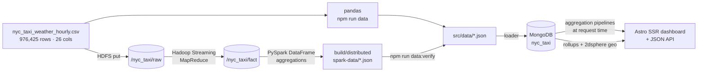

# NYC Taxi × Weather Atlas

An end-to-end **Big Data Analytics** project that joins a full year of New York
City yellow-taxi demand to hourly weather, and turns the result into an
interactive analytical dashboard.

The dataset is every 2025 yellow-taxi pickup, aggregated to `(hour × pickup zone)`
and left-joined to the hourly Open-Meteo weather reading for the city —
**976,425 rows, 26 columns, 34,938,284 trips, $1,030,220,295 in revenue**.

The project answers four questions and makes the *methodology* behind each answer
inspectable, so every headline number can be traced back to a stated aggregation:

1. How does weather change how many trips New Yorkers take?
2. When and where does demand peak?
3. What are the economics of a trip, and who captures them?
4. Does weather change not just *volume* but *where people go* and *what they pay*?

---

## Architecture

The pipeline runs in four stages — **ingestion**, **analysis**, **serving** and
**presentation**. The first two ship as **two interchangeable implementations**:

- a **fast local path** (pandas/numpy) that needs nothing but Python, and
- a **distributed path** (**HDFS + Hadoop Streaming MapReduce + PySpark**) that runs
  the same two stages on a single-node cluster.

Both write the same `src/data/*.json`, so they feed the same MongoDB and the same
dashboard. `npm run data:verify` proves the distributed build reproduces the local
one — this is one result computed twice, not two products.



| Stage | Fast local path | Distributed path | Role |
|---|---|---|---|
| Ingestion | `scripts/aggregate.py` reads the CSV from disk | `scripts/distributed/ingest.sh` lands the extract in HDFS; `fact_mapper.py` + `fact_reducer.py` normalise it with a Hadoop Streaming MapReduce job into `/nyc_taxi/fact` | Produce the normalised `(hour × pickup zone)` fact table. |
| Analysis | pandas/numpy in `aggregate.py`, then `analyse.py` | `scripts/distributed/spark_aggregate.py` runs the same aggregations in PySpark over the HDFS fact table; `verify.py` proves its output equals the pandas cubes, so `analyse.py`'s findings are identical by construction | Trip- and revenue-weighted per-zone profiles, the joint cubes, weather bucketing and the time-controlled comparisons. |
| Serving | **MongoDB** | **MongoDB** | Stores the denormalised extract plus pre-computed rollups, geo shapes (2dsphere) and findings. |
| Presentation | **Astro** (SSR) + TypeScript + hand-written SVG | **Astro** | Server-renders the pages and answers JSON API queries against MongoDB at request time. |

> **Scope of the MapReduce stage.** The repository ships the already-joined
> `(hour × zone)` extract, not the raw monthly TLC trip files, so the MapReduce job
> operates on the landed extract: it re-keys every record by `(hour, zone)`, validates
> it, and performs a trip-weighted merge for any repeated key. Reproducing the
> upstream taxi × weather join would additionally need the raw TLC monthly archives
> and the cached Open-Meteo responses.

### Streams in the graph

| Stream | Content | Role |
|---|---|---|
| `trips` | One doc per `(hour × zone)` — demand, per-trip means, denormalised weather. | The source of truth all aggregations run against. |
| `hourly` | 8,759 docs — the citywide hourly master series. | Time-series view of the whole year. |
| `zones` | 262 docs — names, boroughs, geometry, annual totals. | Zone drilldown + choropleth. |
| `rollups` | Per-dimension profiles and zone joint cubes. | Fast cube lookups without re-scanning 976k rows. |
| `findings` | Every headline number the dashboard prints. | Methodology + viva traceability. |
| `meta` | Provenance, row counts, indexes. | Reproducibility record. |

---

## Data

**Source extract:** `nyc_taxi_weather_hourly.csv`

- **976,425 rows** at `(pickup_hour × PULocationID)`, calendar year **2025**
  (2025-01-01 → 2025-12-31).
- **8,759 distinct hours** — every hour of 2025 except the DST spring-forward hour
  on `2025-03-09 02:00`.
- **262 distinct `PULocationID`** values.
- All **26 columns are numeric and fully populated — zero blanks**, so no imputation
  is performed or needed.

**Weather** is citywide (one Open-Meteo grid reading per hour) and is therefore
repeated across all 262 zone rows for a given hour. Zone-level weather analysis
inherits that limitation and says so in the interface.

**Column groups**

| Group | Columns |
|---|---|
| Demand | `trip_count`, `dropoff_count`, `total_revenue` |
| Per-trip economics | `avg_fare`, `avg_total_amount`, `avg_tip_amount`, `avg_trip_distance`, `avg_passenger_count`, `avg_trip_duration_min` |
| Weather | `temperature_2m`, `apparent_temperature`, `relative_humidity_2m`, `precipitation`, `rain`, `snowfall`, `weather_code`, `wind_speed_10m`, `wind_gusts_10m`, `cloud_cover` |
| Calendar | `hour_of_day`, `day_of_week`, `is_weekend`, `month`, `day_of_month`, `pickup_hour` |

**Fidelity notes**

- `total_revenue` reconciles exactly with `trip_count × avg_total_amount`
  (ratio `1.0000`); `avg_total_amount` already includes tip, tolls and surcharges,
  so `fare + tip` does **not** sum to it.
- The extract carries a **`dropoff_count`** marginal but no dropoff-*zone* column,
  so it supports origin density, destination density and net flow — but **not** a
  pairwise origin–destination matrix. The dashboard states this limit rather than
  implying flows it cannot compute.
- Zone **names and boroughs are not in the extract** (numeric IDs only). They are
  joined from the official NYC TLC zone file (NYC Open Data dataset `8meu-9t5y`),
  cited wherever they appear. 258 of the 262 zones resolve; the rest stay unmapped.

---

## MongoDB data model

Database `nyc_taxi` (override with `MONGO_URI` / `MONGO_DB`):

| Collection | Docs | Notes |
|---|---|---|
| `trips` | 976,425 | Indexed on `(hour)`, `(zone)`, `(hour, zone)`, `(cal.mon, cal.hod)`, `(weather.kind)`, `(precip)`. |
| `hourly` | 8,759 | Unique index on `hour`; citywide master series. |
| `zones` | 262 | Unique `id`, **2dsphere** index on `geometry`. |
| `rollups` | 12 | Per-dimension profiles + zone joint cubes (`zone_by_hour`, `zone_by_weather`, `zone_month_hour`, …). |
| `findings` | 1 | Computed by the analysis stage. |
| `meta` | 1 | Provenance: rows, hours, zones, date range, index list, load time. |

---

## Dashboard

Seven surfaces, driven by one filter bar (month · day-of-week · hour-of-day ·
weather kind) that maps to a single `$match`, so a change of lens is one query
shape with different bounds.

| Surface | Route | Answers |
|---|---|---|
| Overview | `/` | The year's shape in one screen. |
| Cab | `/cab` | Demand by hour / weekday / month, concentration, borough split. |
| Weather | `/weather` | Weather-code profile, seasonality, weather distributions. |
| Cab × Weather | `/interaction` | The controlled rain / snow / temperature effect. |
| Zones & map | `/zones` | Choropleth + ranking table, drill into any zone. |
| Origin & destination | `/flow` | Origin density, destination density and net flow per zone. |
| Forecast | `/forecast` | Out-of-sample demand forecast for 1–7 Jan 2026, with error. |
| Method | `/method` | Methodology and fidelity notes for every figure. |

**Key findings** (all controlled inside `(month × hour-of-day)` cells; the naive
figure is shown for contrast):

| # | Finding | Controlled | Naive |
|---|---|---|---|
| 1 | Rain's effect on trips | **−0.3 %** (R²=0.829, weather adds ~0.0003 of variance) | +11.2 % |
| 2 | Snow's effect on trips | **−4.8 %** (135 snow hours) | −24.2 % |
| 3 | Long-haul zones (mean dist > 8 mi) | **9.1 % of trips, 23.8 % of revenue** | — |
| 4 | Peak-to-trough demand | **95×** (9,746 vs 103 trips/h) | — |

Also worth noting: tip rate is **18.8 %** of fare and the citywide average
revenue per trip is **$29.49**.

---

## Forecasting

The `/forecast` surface adds a genuinely predictive stage on top of the
descriptive analysis.

- **Model:** ridge regression on `log1p(trips per hour)`, fitted on calendar
  features (cyclical hour / weekday / day-of-year, weekend), weather variables,
  and three lag terms (same hour yesterday, same hour last week, trailing 24-hour
  mean).
- **Split:** strictly temporal — train on 1 Jan – 5 Nov 2025, test on the
  **56 held-out days** (6 Nov – 31 Dec).
- **Baseline:** seasonal-naive (same hour, same weekday, previous week).

| Metric | Model | Baseline |
|---|---|---|
| MAE (trips/h) | **601** | 681 |
| RMSE | **949** | 1,162 |
| MAPE | **23.8 %** | 28.7 % |
| R² | **0.851** | 0.776 |

The model beats the seasonal-naive rule by **+11.7 % MAE** on data it never saw,
then forecasts **1–7 January 2026**. Future weather is unknown, so it is held at
the last 30-day mean — a stated assumption, not a hidden one. The forecast is
citywide volume only; it does not predict revenue or per-zone demand.

Reproduce with `python3 scripts/forecast.py` (also run by `npm run data`).

---

## Project structure

```
.
├── nyc_taxi_weather_hourly.csv   # 113 MB source extract (see Getting started)
├── scripts/
│   ├── aggregate.py              # aggregation stage  → src/data/*.json
│   ├── analyse.py                # analysis stage     → findings
│   ├── load_mongo.py             # MongoDB loader     → trips/hourly/zones/rollups
│   ├── findings.txt              # human-readable analysis output
│   ├── shoot.mjs                 # Playwright screenshot pass
│   └── distributed/              # the HDFS + MapReduce + PySpark path
│       ├── env.sh                #   JAVA_HOME / HADOOP_HOME / SPARK_HOME / HDFS
│       ├── hdfs-up.sh            #   start the NameNode + DataNode
│       ├── hdfs-down.sh          #   stop them
│       ├── ingest.sh             #   put the extract at /nyc_taxi/raw
│       ├── run-fact-job.sh       #   Hadoop Streaming job → /nyc_taxi/fact
│       ├── fact_mapper.py        #   mapper: re-key by (hour, zone)
│       ├── fact_reducer.py       #   reducer: trip-weighted merge
│       ├── spark_aggregate.py    #   PySpark → same JSON as aggregate.py
│       ├── run-spark.sh          #   spark-submit wrapper
│       ├── run-all.sh            #   ingest → MapReduce → Spark → verify
│       └── verify.py             #   prove the two builds agree
├── src/
│   ├── pages/                    # Astro surfaces + JSON API routes
│   │   ├── api/[...path].ts      #   one dispatcher for every aggregation
│   │   └── api/zone/[id].ts      #   per-zone detail
│   ├── server/
│   │   ├── db.ts                 # Mongo client (pooled, response-cached)
│   │   └── pipelines.ts          # every aggregation the dashboard shows
│   ├── data/                     # aggregated snapshots served to the client
│   ├── components/               # Sidebar, Topbar
│   ├── layouts/Shell.astro
│   ├── scripts/                  # client-side charts, map, filters
│   └── styles/                   # design tokens + app CSS
├── public/
│   ├── geo/taxi_zones.geojson    # TLC zone geometry (choropleth)
│   └── fonts/archivo-var-latin.woff2
├── DESIGN.md                     # visual system record
└── PRODUCT.md                    # product brief
```

---

## Getting started

**Prerequisites (fast local path):** Node 20+, Python 3.11+, MongoDB (`mongod`)
running locally.

**Prerequisites (distributed path, optional):** JDK 11, a Hadoop 3.3.x install
(`HADOOP_HOME`) and an Apache Spark 3.5.x tarball (`SPARK_HOME`). The helpers in
`scripts/distributed/` set `JAVA_HOME`, `PYSPARK_PYTHON` and the cluster paths for
you; nothing else needs configuring.

```bash
# 1. install dashboard dependencies
npm install

# 2. configure the database (defaults shown)
cat > .env <<'EOF'
MONGO_URI=mongodb://127.0.0.1:27017
MONGO_DB=nyc_taxi
EOF

# 3. place the source extract at the repo root
#    nyc_taxi_weather_hourly.csv  (113 MB — not committed, see below)
```

> **Why the CSV isn't in the repo:** it is 113 MB, above GitHub's 100 MB per-file
> limit. Put `nyc_taxi_weather_hourly.csv` at the repository root before running
> the pipeline; the checked-out code, geo files and aggregated snapshots are
> sufficient to run the dashboard against an already-loaded database.

```bash
# run the pipeline (aggregate → analyse → load MongoDB)
npm run data        # python3 scripts/aggregate.py && python3 scripts/analyse.py
python3 -m venv .venv && .venv/bin/pip install pandas numpy pymongo
npm run db:load     # .venv/bin/python scripts/load_mongo.py

# start the dashboard
npm run dev         # http://localhost:4321
```

### Distributed path (HDFS + MapReduce + PySpark)

Runs the first two stages on a local single-node cluster and checks the result
against the pandas build. `scripts/distributed/env.sh` resolves `HADOOP_HOME` and
`SPARK_HOME` (defaults: `~/hadoop-env/hadoop-3.3.6` and
`~/spark-env/spark-3.5.3-bin-hadoop3`); override them in the environment if yours
live elsewhere.

```bash
npm run hdfs:up          # start the NameNode + DataNode, wait for safe mode off
npm run hdfs:ingest      # hdfs -put the extract at /nyc_taxi/raw
npm run mr:fact          # Hadoop Streaming MapReduce → /nyc_taxi/fact
npm run data:spark       # PySpark aggregation → build/distributed/spark-data
npm run data:verify      # compare that output against src/data (must PASS)
```

`npm run data:distributed` chains all five. To promote the verified Spark output
over the committed snapshots:

```bash
cp build/distributed/spark-data/*.json src/data/
```

**Build & run for production (SSR):**

```bash
npm run build       # astro build (Node standalone adapter)
npm start           # node ./dist/server/entry.mjs
```

**Reproducibility.** The committed scripts re-run each pipeline stage end to end
on a single machine, so the extract and every served number can be regenerated
without the cluster. The analysis is deterministic: `scripts/analyse.py` writes
both `src/data/findings.json` and the human-readable `scripts/findings.txt`, and
`load_mongo.py` records the row counts, index list and load time in `meta`. The
distributed path (HDFS + MapReduce + PySpark) reproduces the same `src/data`
payloads from the same extract, and `npm run data:verify` checks that field by
field — integer counts exactly, rounded values within rounding tolerance.

---

## API

Every figure is served by one dispatcher — `/api/<pipeline>?mon=&dow=&hod=&kind=`
— so the exposed query surface is exactly as large as the set of aggregations it
offers. `GET /api/zone/<id>` returns a single zone's detail.

```
summary            cab/hour        cab/dow         cab/month      cab/matrix
cab/concentration  cab/series      cab/borough     weather/code   weather/kind
weather/season     weather/vars    weather/economics
interaction/rain   interaction/temp  interaction/zone-shift
flow/zones         flow/hour       zones           zones/near     meta
```

---

## Notes & limitations

- Weather is a single citywide reading per hour; zone-level weather effects inherit
  that resolution and are labelled as such.
- No origin–destination matrix (no dropoff-zone column) — only origin/destination
  marginals and net flow.
- Multi-zone and citywide averages are **re-weighted by `trip_count`**, never
  averaged naively across per-`(hour, zone)` means.
- The one absent hour (`2025-03-09 02:00`, DST) is handled by indexing on
  day-of-year + hour rather than a dense date range, which would otherwise shift
  every later timestamp.

**Credits.** NYC TLC trip records (NYC Open Data) and Open-Meteo hourly weather.
TLC taxi-zone geometry: NYC Open Data dataset `8meu-9t5y`.
