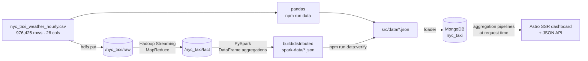

# NYC Taxi × Weather Atlas

An end-to-end **Big Data Analytics** project: a full year of New York City
yellow-taxi demand joined to hourly weather, analysed with **Hadoop + PySpark**,
served from **MongoDB**, and presented as an interactive **Astro** dashboard.

> **The one-line version.** Weather barely changes *how many* trips New Yorkers
> take — but it changes *where* they go, and snow matters more than rain. The
> dashboard lets you check that claim on every cut of the data.

| | |
|---|---|
| **Rows** | 976,425 `(hour × pickup zone)` records |
| **Coverage** | 2025-01-01 → 2025-12-31 · 8,759 hours · 262 zones |
| **Trips** | 34,938,284 |
| **Revenue** | $1,030,220,295 |
| **Stack** | Hadoop (HDFS + MapReduce) · PySpark · MongoDB · Astro/TypeScript |
| **Pages** | 8 analytical surfaces + a JSON API |
| **Forecast** | 1–7 Jan 2026 · MAE 601 trips/h · **+11.7 %** better than seasonal-naive |

---

## Contents

1. [What this project does](#1-what-this-project-does)
2. [Quick start](#2-quick-start)
3. [Architecture](#3-architecture)
4. [The data](#4-the-data)
5. [The pipeline, stage by stage](#5-the-pipeline-stage-by-stage)
6. [The dashboard](#6-the-dashboard)
7. [What the data says](#7-what-the-data-says)
8. [Forecasting](#8-forecasting)
9. [MongoDB data model](#9-mongodb-data-model)
10. [API](#10-api)
11. [Methods: why the numbers are trustworthy](#11-methods-why-the-numbers-are-trustworthy)
12. [Project structure](#12-project-structure)
13. [Running it](#13-running-it)
14. [Troubleshooting](#14-troubleshooting)
15. [Limitations and honest notes](#15-limitations-and-honest-notes)
16. [Viva cheat sheet](#16-viva-cheat-sheet)
17. [Credits](#17-credits)

---

## 1. What this project does

It answers four questions, and makes the method behind each answer inspectable:

1. **How does weather change how many trips people take?**
2. **When and where does demand peak?**
3. **What are the economics of a trip, and who captures them?**
4. **Does weather change not just volume, but *where people go* and *what they pay*?**

The important twist is **how** the weather questions are answered. Comparing all
wet hours with all dry hours gives a misleading **+11.2 %** rain effect, because it
rains more often at busy times of day. The dashboard controls for month and hour
of day first, and the effect collapses to **−0.3 %**. That gap — naive versus
controlled — is the intellectual core of the project.

Everything is interactive: pick a month, weekday, hour or weather type and every
panel re-queries MongoDB with that lens.

---

## 2. Quick start

**You need:** Node 20+, Python 3.11+, and MongoDB running locally.

```bash
# 1. dependencies
npm install

# 2. put the source extract at the repo root (not committed — 113 MB)
#    nyc_taxi_weather_hourly.csv

# 3. Python environment for the loader
python3 -m venv .venv
.venv/bin/pip install pandas numpy pymongo

# 4. build the aggregates, findings and forecast
npm run data          # aggregate.py → analyse.py → forecast.py

# 5. load MongoDB
npm run db:load

# 6. start the dashboard
npm run dev           # http://localhost:4321
```

If the database is already loaded, you can skip straight to `npm run dev`.

---

## 3. Architecture

The pipeline has four stages. The first two ship as **two interchangeable
implementations** that produce byte-for-byte-equivalent JSON:

- a **fast local path** — pandas/numpy, needs nothing but Python;
- a **distributed path** — HDFS + Hadoop Streaming MapReduce + PySpark, runs on a
  single-node cluster.

The distributed path is not a decoration: `npm run data:verify` compares its
output field by field against the pandas build. If they disagree, it fails. So
the project demonstrates the cluster stack **and** keeps a path that runs on any
laptop.



| Stage | Fast local path | Distributed path | What it produces |
|---|---|---|---|
| **1. Ingestion** | `scripts/aggregate.py` reads the CSV | `ingest.sh` → HDFS; `fact_mapper.py` + `fact_reducer.py` normalise it | The `(hour × pickup zone)` fact table |
| **2. Analysis** | pandas/numpy + `analyse.py` | `spark_aggregate.py` (PySpark), checked by `verify.py` | Citywide series, zone profiles, cubes, findings |
| **3. Serving** | MongoDB | MongoDB | Indexed collections + rollups + geo |
| **4. Presentation** | Astro SSR + SVG | Astro SSR + SVG | 8 pages + JSON API |

**What happens when you open a page:** Astro renders the shell on the server, the
browser fetches `/api/<pipeline>?mon=&dow=&hod=&kind=`, and `src/server/pipelines.ts`
runs a MongoDB aggregation pipeline (`$match`, `$group`, `$bucket`, `$lookup`,
`$geoNear`) against the 976k-row `trips` collection. Results are cached in-process
for 45 s. The charts are hand-written SVG — no chart library.

---

## 4. The data

**Source extract:** `nyc_taxi_weather_hourly.csv`

- **976,425 rows**, one per `(pickup_hour × PULocationID)`.
- **2025 only**, 2025-01-01 → 2025-12-31.
- **8,759 distinct hours** — every hour except the DST spring-forward hour
  (`2025-03-09 02:00`).
- **262 distinct pickup zones.**
- All **26 columns are numeric and fully populated — zero blanks**, so no
  imputation is performed or needed.

**Why the extract is already aggregated:** the raw TLC trip files contain one row
per trip. Grouping them to `(hour × zone)` reduces tens of millions of records to
under a million while keeping every quantity the dashboard needs. The trade-off is
stated honestly below: per-trip means and two marginals, not individual trips.

**Weather** is a single citywide Open-Meteo reading per hour, repeated across all
262 zone rows. Zone-level weather analysis therefore inherits that limitation.

| Group | Columns |
|---|---|
| Demand | `trip_count`, `dropoff_count`, `total_revenue` |
| Per-trip economics | `avg_fare`, `avg_total_amount`, `avg_tip_amount`, `avg_trip_distance`, `avg_passenger_count`, `avg_trip_duration_min` |
| Weather | `temperature_2m`, `apparent_temperature`, `relative_humidity_2m`, `precipitation`, `rain`, `snowfall`, `weather_code`, `wind_speed_10m`, `wind_gusts_10m`, `cloud_cover` |
| Calendar | `hour_of_day`, `day_of_week`, `is_weekend`, `month`, `day_of_month`, `pickup_hour` |

**Fidelity notes**

- `total_revenue` reconciles exactly with `trip_count × avg_total_amount`
  (ratio `1.0000`). `avg_total_amount` already includes tip, tolls and
  surcharges, so `fare + tip` does **not** sum to it.
- `dropoff_count` is a **marginal**, not a dropoff-zone column. It supports origin
  density, destination density and net flow, but **not** a pairwise
  origin–destination matrix. The dashboard says so rather than inventing flows.
- Zone **names and boroughs are not in the extract** (numeric IDs only). They are
  joined from the official NYC TLC zone file (NYC Open Data `8meu-9t5y`).
  258 of the 262 zones resolve; the rest stay unmapped and grey on the map.

---

## 5. The pipeline, stage by stage

### Stage 1 — Ingestion (Hadoop)

The raw extract is landed in HDFS at `/nyc_taxi/raw`. A **Hadoop Streaming
MapReduce** job then normalises it:

- **Mapper** (`fact_mapper.py`) parses each CSV line and re-keys it by
  `(pickup_hour, PULocationID)`. It does no aggregation — it just makes the
  shuffle group every record for a key onto one reducer.
- **Reducer** (`fact_reducer.py`) collapses each key to one fact row. Because the
  extract is already one row per `(hour, zone)`, this is normally an identity
  pass; if a key repeats, count-like columns are summed and per-trip means are
  **re-weighted by `trip_count`**, never naively averaged.

The result is a tab-separated fact table at `/nyc_taxi/fact`.

> **Scope note.** The repository ships the already-joined extract, not the raw
> monthly TLC archives. Reproducing the upstream taxi × weather join would need
> those archives and the cached Open-Meteo responses. The MapReduce stage covers
> the normalisation step on the landed extract, which is what the shipped data
> requires.

### Stage 2 — Analysis (PySpark + pandas)

`spark_aggregate.py` reads the HDFS fact table with a fixed schema and runs the
heavy aggregations as Spark DataFrames:

- the 8,759-hour citywide series (trip-weighted means);
- 262 zone profiles;
- the joint cubes: zone × hour, zone × weekday, zone × month, zone × weather,
  zone × temperature, month × hour, weekday × hour.

It writes `citywide.json` and `zones.json` to `build/distributed/spark-data/`.
Only the final JSON assembly happens on the driver.

The pandas path (`aggregate.py`) does the same work on one machine. `verify.py`
compares the two: integer counts and every trip cube must match exactly; display
values are allowed their rounding step. `src/data` keeps the pandas build until
the check passes.

`analyse.py` then derives the findings — the controlled comparisons, the OLS
regression, the significance tests and the zone redistribution — and writes both
`src/data/findings.json` (machine-readable) and `scripts/findings.txt` (readable).

### Stage 3 — Serving (MongoDB)

`load_mongo.py` drops and rebuilds the collections this project owns, creates the
indexes, and records provenance in `meta`. It is idempotent: re-running it is safe.

### Stage 4 — Presentation (Astro)

Astro runs in SSR mode with the Node adapter. Pages are rendered on request, and
the browser talks to one JSON dispatcher. There is no chart library: every chart
is SVG generated by `src/scripts/charts.ts`.

---

## 6. The dashboard

Eight surfaces, driven by one filter bar (month · weekday · hour · weather kind).

| Page | Route | The question it answers | What to look at |
|---|---|---|---|
| **Overview** | `/` | What did the year look like? | The shape of demand, the headline numbers. |
| **Cab** | `/cab` | When does the city ride? | Hour-of-day peak, weekday pattern, concentration. |
| **Weather** | `/weather` | What was the weather actually like? | 13 weather types, rainfall, temperature, month by month. |
| **Cab × Weather** | `/interaction` | What does weather *do*? | Naive vs controlled rain line — the core argument. |
| **Zones & map** | `/zones` | Where do trips start? | Choropleth, ranking, zone drilldown. |
| **Origin & destination** | `/flow` | Who leaves, who arrives? | Pickups vs dropoffs, net flow. |
| **Forecast** | `/forecast` | What happens next week? | Backtest, 1–7 Jan 2026 forecast, error metrics. |
| **Method** | `/method` | How do I trust this? | Provenance, line counts, rules and limits. |

The filter bar applies the same `$match` to every panel, so a lens change is one
query shape with different bounds.

---

## 7. What the data says

All comparisons are controlled inside `(month × hour-of-day)` cells. The naive
figure is shown to make the confound visible.

| # | Finding | Controlled | Naive |
|---|---|---|---|
| 1 | Rain's effect on trips | **−0.3 %** | +11.2 % |
| 2 | Snow's effect on trips | **−4.8 %** (135 snow hours) | −24.2 % |
| 3 | Long-haul zones (> 8 mi mean) | **9.1 % of trips, 23.8 % of revenue** | — |
| 4 | Peak-to-trough demand | **95×** (9,746 vs 103 trips/h) | — |

The OLS model says the same thing: `log(trips)` is 82.9 % explained by calendar
alone (hour + month + weekend), and adding precipitation and snowfall raises R²
by only **0.0003**. Weather is real, but it is a small term next to the clock.

Other numbers worth knowing: tip rate **18.8 %** of fare, revenue per trip
**$29.49**, top 10 zones carry **40.5 %** of all trips.

---

## 8. Forecasting

The `/forecast` page adds a genuinely predictive stage.

- **Model:** ridge regression on `log1p(trips per hour)`.
- **Features:** cyclical hour, weekday and day-of-year; a weekend flag;
  temperature, precipitation, snow, humidity, wind and cloud; three lag terms
  (same hour yesterday, same hour last week, trailing 24-hour mean).
- **Split:** strictly temporal — train 1 Jan – 5 Nov 2025, test the **56 held-out
  days** (6 Nov – 31 Dec). No shuffling, no leakage.
- **Baseline:** seasonal-naive — same hour, same weekday, previous week. This is
  the rule an operator already has for free, so the model has to beat it.

| Metric | Model | Baseline |
|---|---|---|
| MAE (trips/h) | **601** | 681 |
| RMSE | **949** | 1,162 |
| MAPE | **23.8 %** | 28.7 % |
| R² | **0.851** | 0.776 |

The model wins by **+11.7 % MAE** on data it never saw, then forecasts
**1–7 January 2026**.

**Assumptions, stated openly:**

- Future weather is unknown, so the 7-day forecast holds weather at the last
  30-day mean.
- The forecast is **citywide volume only** — not revenue, not per-zone demand.
- The last week of the backtest is New Year's, where the previous week stops being
  a good guide; the page says so next to the chart.

Reproduce with `python3 scripts/forecast.py` (also run by `npm run data`).

---

## 9. MongoDB data model

Database `nyc_taxi` (override with `MONGO_URI` / `MONGO_DB`):

| Collection | Docs | Purpose | Indexes |
|---|---|---|---|
| `trips` | 976,425 | One doc per `(hour × zone)`; the source of truth | `hour`, `zone`, `(hour, zone)`, `(cal.mon, cal.hod)`, `weather.kind`, `precip` |
| `hourly` | 8,759 | Citywide hourly master series | Unique `hour`; `(cal.mon, cal.hod)` |
| `zones` | 262 | Names, boroughs, geometry, annual totals | Unique `id`; **2dsphere** on `geometry` |
| `rollups` | 12 | Per-dimension profiles + zone joint cubes | — |
| `findings` | 1 | Every headline number | — |
| `meta` | 1 | Provenance, row counts, index list, load time | — |

The 2dsphere index powers a real `$geoNear` radius search on `/api/zones/near`.

---

## 10. API

One dispatcher — `/api/<pipeline>?mon=&dow=&hod=&kind=` — so the exposed query
surface is exactly as large as the aggregations it offers. `GET /api/zone/<id>`
returns a single zone's detail.

```
summary            cab/hour        cab/dow         cab/month      cab/matrix
cab/concentration  cab/series      cab/borough     weather/code   weather/kind
weather/season     weather/vars    weather/economics
interaction/rain   interaction/temp  interaction/zone-shift
flow/zones         flow/hour       zones           zones/near
forecast           meta
```

Every response is JSON; errors come back as `{ "error": "..." }` with a non-2xx
status, and panels show the failure instead of an empty chart.

---

## 11. Methods: why the numbers are trustworthy

This is the part an evaluator will probe.

### 11.1 Trip-weighted aggregation

The rows are per-`(hour, zone)` **means**, not raw trips. Averaging those means
naively over-counts quiet zones. Every citywide or multi-zone average is re-weighted
by `trip_count`:

```python
np.average(values, weights=trip_count)
```

This is the single most important correctness rule in the project.

### 11.2 Stratified (cell-controlled) comparison

Rain and time-of-day are confounded. Instead of comparing all wet hours to all dry
hours, the code compares wet vs dry **inside the same `(month × hour-of-day)`
cell**, then trip-weight-averages the per-cell ratios.

- Naive rain effect: **+11.2 %**
- Controlled rain effect: **−0.3 %**

That inversion is the headline. It is the same idea as a fixed-effects model,
implemented as explicit stratification.

### 11.3 OLS regression (the only "model" in the descriptive part)

```
log(trips) ~ 23 hour dummies + 11 month dummies + weekend + precip + snowfall
```

Fitted with `numpy.linalg.lstsq`. Standard errors from `s²(XᵀX)⁻¹`, t-statistics,
R². Results: R² = 0.829, precipitation **+1.59 %** per mm/h (t = +2.3), snowfall
**−19.8 %** per cm/h (t = −3.2).

This is **inferential**, not predictive: it is fitted and read on the same data,
with no train/test split and no future values. The forecasting page is separate
and genuinely out-of-sample.

### 11.4 Significance testing

Zone share shifts use a two-proportion **z-test**, with **Bonferroni correction**
for multiple comparisons. The page reports effect sizes next to p-values and warns
against reading p-values alone.

### 11.5 Compositional analysis

For "where did demand move when it rained", the code compares each zone's **share**
of wet-hour trips with its share of dry-hour trips (`share_wet / share_dry`), plus
the percentage-point change. This answers *composition*, not just volume.

### 11.6 Forecast metrics

MAE, RMSE, MAPE and R² are computed on the held-out 56 days, in trips per hour.
The seasonal-naive baseline is evaluated on exactly the same rows.

---

## 12. Project structure

```
.
├── nyc_taxi_weather_hourly.csv   # 113 MB source extract (not committed)
├── scripts/
│   ├── aggregate.py              # pandas aggregation → src/data/*.json
│   ├── analyse.py                # controlled findings → findings.json
│   ├── forecast.py               # ridge model    → forecast.json
│   ├── load_mongo.py             # MongoDB loader  → trips/hourly/zones/rollups
│   ├── findings.txt              # human-readable analysis output
│   ├── shoot.mjs                 # Playwright screenshot pass
│   └── distributed/              # HDFS + MapReduce + PySpark path
│       ├── env.sh                #   JAVA_HOME / HADOOP_HOME / SPARK_HOME / HDFS
│       ├── hdfs-up.sh            #   start the NameNode + DataNode
│       ├── hdfs-down.sh          #   stop them
│       ├── ingest.sh             #   put the extract at /nyc_taxi/raw
│       ├── run-fact-job.sh       #   Hadoop Streaming job → /nyc_taxi/fact
│       ├── fact_mapper.py        #   mapper: re-key by (hour, zone)
│       ├── fact_reducer.py       #   reducer: trip-weighted merge
│       ├── spark_aggregate.py    #   PySpark → same JSON as aggregate.py
│       ├── run-spark.sh          #   spark-submit wrapper
│       ├── run-all.sh            #   ingest → MapReduce → Spark → verify
│       └── verify.py             #   prove the two builds agree
├── src/
│   ├── pages/                    # 8 Astro surfaces + JSON API
│   │   ├── index.astro           #   overview
│   │   ├── cab.astro
│   │   ├── weather.astro
│   │   ├── interaction.astro
│   │   ├── zones.astro
│   │   ├── flow.astro
│   │   ├── forecast.astro
│   │   ├── method.astro
│   │   ├── zone/[id].astro       #   per-zone drilldown
│   │   ├── api/[...path].ts      #   one dispatcher for every aggregation
│   │   └── api/zone/[id].ts      #   per-zone detail
│   ├── server/
│   │   ├── db.ts                 # Mongo client (pooled, response-cached)
│   │   └── pipelines.ts          # every aggregation the dashboard shows
│   ├── data/                     # aggregated snapshots (citywide, zones, findings, forecast)
│   ├── components/               # Sidebar, Topbar
│   ├── layouts/Shell.astro
│   ├── scripts/                  # client charts, map, filters
│   └── styles/                   # design tokens + app CSS
├── public/
│   ├── geo/taxi_zones.geojson    # TLC zone geometry (choropleth)
│   └── fonts/archivo-var-latin.woff2
├── DESIGN.md                     # visual system record
└── PRODUCT.md                    # product brief
```

---

## 13. Running it

### 13.1 Local (fast path)

**Prerequisites:** Node 20+, Python 3.11+, MongoDB running locally.

```bash
npm install
python3 -m venv .venv
.venv/bin/pip install pandas numpy pymongo
npm run data       # aggregate → analyse → forecast
npm run db:load    # load MongoDB
npm run dev        # http://localhost:4321
```

### 13.2 Distributed path (HDFS + MapReduce + PySpark)

**Prerequisites:** JDK 11, Hadoop 3.3.x (`HADOOP_HOME`), Spark 3.5.x
(`SPARK_HOME`). Defaults in `scripts/distributed/env.sh`:
`~/hadoop-env/hadoop-3.3.6` and `~/spark-env/spark-3.5.3-bin-hadoop3`.

```bash
npm run hdfs:up          # start NameNode + DataNode, wait for safe mode off
npm run hdfs:ingest      # put the extract at /nyc_taxi/raw
npm run mr:fact          # Hadoop Streaming MapReduce → /nyc_taxi/fact
npm run data:spark       # PySpark aggregation → build/distributed/spark-data
npm run data:verify      # compare against src/data (must PASS)
```

`npm run data:distributed` chains all five. After a PASS you can promote the
Spark output:

```bash
cp build/distributed/spark-data/*.json src/data/
```

### 13.3 Production build (SSR)

```bash
npm run build       # astro build (Node standalone adapter)
npm start           # node ./dist/server/entry.mjs
```

### 13.4 Useful checks

```bash
npm run check       # astro check (types)
npm run db:shell    # mongosh nyc_taxi
```

---

## 14. Troubleshooting

| Symptom | Cause | Fix |
|---|---|---|
| Spark fails with `Subject.getSubject` | Spark picked up JDK 23/25 | Export JDK 11: `export JAVA_HOME=/opt/homebrew/opt/openjdk@11/libexec/openjdk.jdk/Contents/Home` (`env.sh` does this) |
| PySpark worker fails on import | PySpark 3.5 supports Python ≤ 3.11; the venv may be newer | `env.sh` sets `PYSPARK_PYTHON=/usr/bin/python3` |
| Dashboard shows `MongoServerSelectionError` | `mongod` not running | Start MongoDB, or check `MONGO_URI` in `.env` |
| Port 4321 already in use | Another dev server | `lsof -ti tcp:4321 \| xargs kill` |
| `npm run db:load` fails | venv missing `pymongo` | `.venv/bin/pip install pymongo` |
| `npm run data` fails | CSV missing | Put `nyc_taxi_weather_hourly.csv` at the repo root |
| Spark Master UI shows no apps | Normal — a PySpark job only appears while it runs | Submit a job; the App UI is on `:4040` |

---

## 15. Limitations and honest notes

- **Weather is citywide**, one reading per hour, shared by all 262 zones. Zone-level
  weather effects inherit that resolution.
- **No origin–destination matrix** — there is no dropoff-zone column. The project
  provides origin density, destination density and net flow, and says so.
- **No ML model in the descriptive analysis.** The OLS regression is inferential,
  not predictive. Only `/forecast` is genuinely out-of-sample.
- **Per-trip means are aggregated**, so distributional questions ("what does the
  median trip look like?") cannot be answered from this extract.
- **The CSV is not committed** (113 MB, above GitHub's 100 MB per-file limit).
  The aggregated snapshots are committed, so the dashboard runs against an
  already-loaded database without it.
- The single missing hour (`2025-03-09 02:00`, DST) is handled by indexing on
  day-of-year + hour, not a dense date range that would shift every later index.

---

## 16. Viva cheat sheet

| Question | Short answer |
|---|---|
| *Where is Hadoop used?* | HDFS stores the raw extract and the normalised fact table; a Hadoop Streaming MapReduce job does the parse + re-key + trip-weighted merge. |
| *Where is PySpark used?* | `spark_aggregate.py` runs the citywide series and all zone × dimension cubes as DataFrame aggregations over the HDFS fact table, then `verify.py` checks it against pandas. |
| *Where is MongoDB used?* | It is the serving layer: indexed `trips`, pre-computed `rollups`, 2dsphere geo, and the aggregation pipelines every panel runs at request time. |
| *Where is the ML?* | One ridge regression on the forecast page, evaluated on 56 held-out days. The rest is descriptive and inferential statistics. |
| *Why is the rain effect −0.3 % and not +11 %?* | The naive figure is confounded by time of day and season; the controlled figure compares wet vs dry inside month × hour cells. |
| *Why weight by trip_count?* | Rows are per-(hour, zone) means; an unweighted average over-counts quiet zones. |
| *How do you know the two pipelines agree?* | `npm run data:verify` compares Spark and pandas field by field; integer counts and cubes must match exactly. |
| *What can't this dataset answer?* | Origin→destination pairs, per-trip distributions, and zone-level weather exposure (weather is citywide). |

---

## 17. Credits

- **NYC TLC** yellow-taxi trip records — NYC Open Data.
- **Open-Meteo** hourly weather.
- **TLC taxi-zone geometry** — NYC Open Data dataset `8meu-9t5y`.
- Typeface: **Archivo** (variable), self-hosted.
